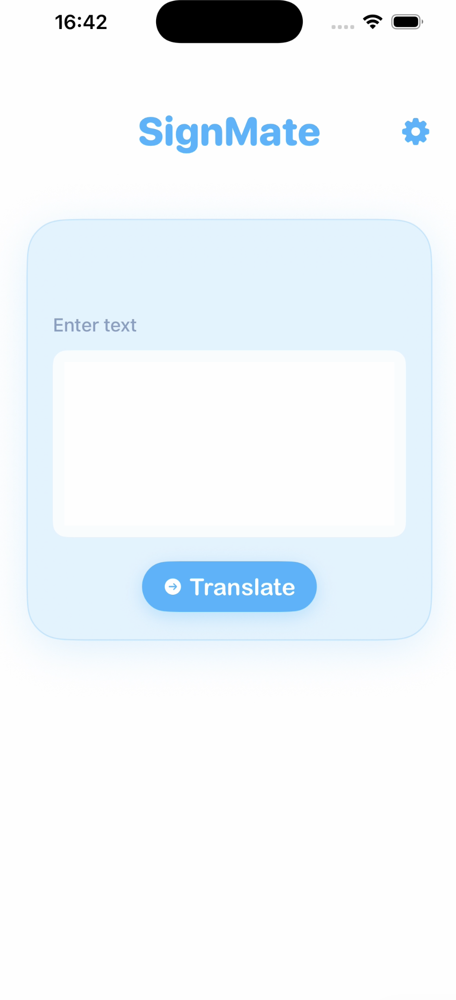
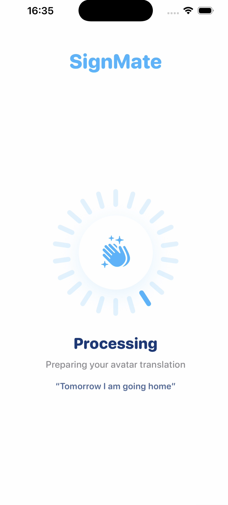
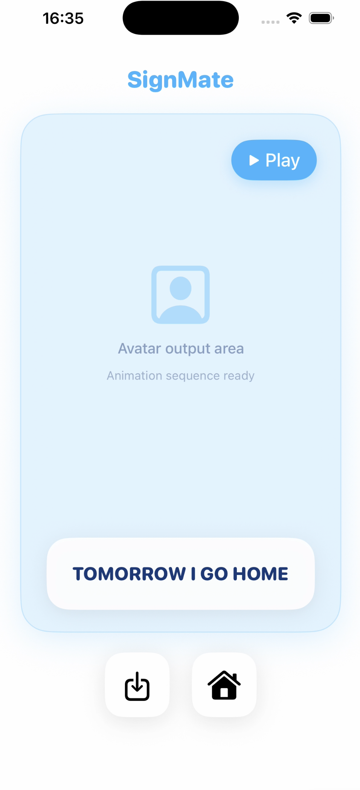
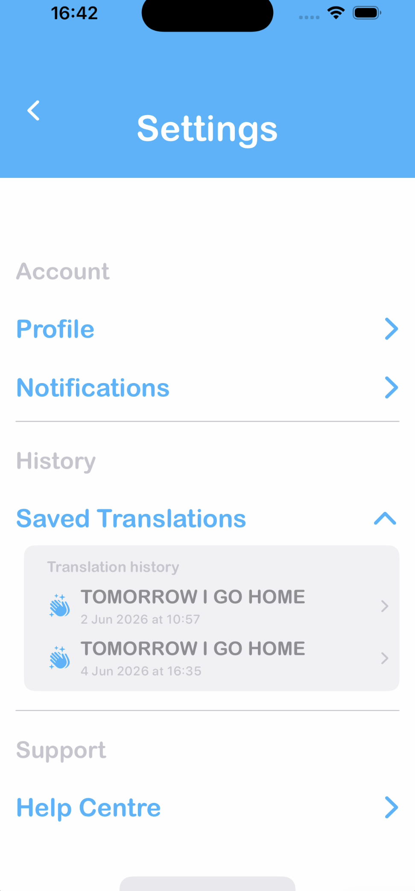
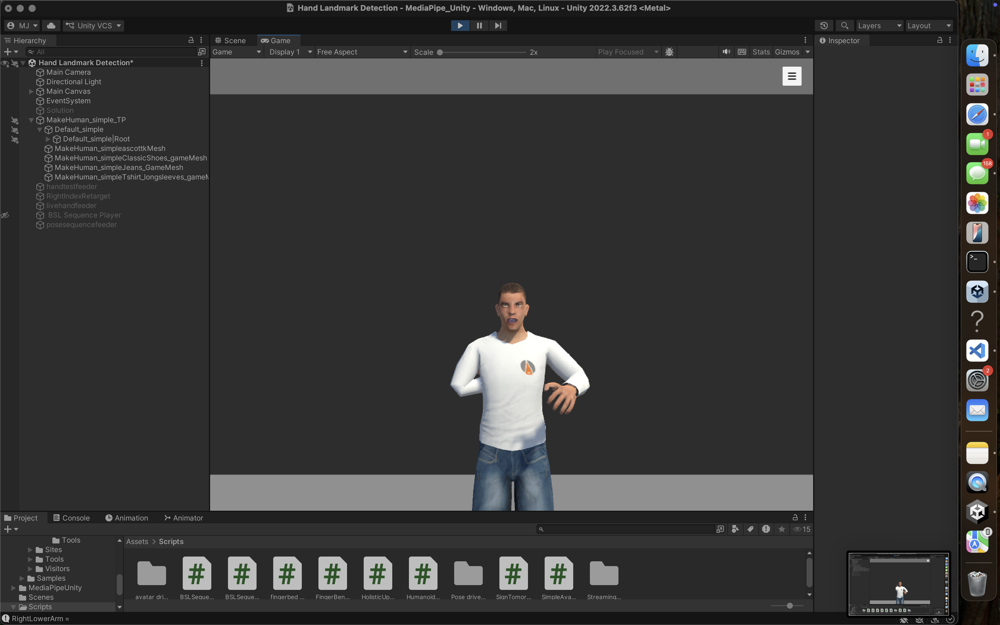
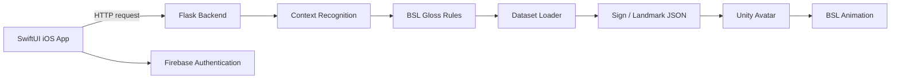

# SignMate

SignMate is an iOS application developed to explore English-to-British Sign Language (BSL) translation through natural language processing and an animated 3D avatar.

The project combines a SwiftUI mobile application, a Python/Flask translation backend, BSL gloss processing, landmark-based sign data and a Unity avatar pipeline.

> This project was originally developed as a final-year Computer Science group project at the University of Kent. This repository is a curated portfolio version of the submitted project. The original datasets and their derived landmark sequences are **not included** in this public edition.

---

## Overview

SignMate was designed to take an English sentence and transform it into a representation that could be used to drive a BSL avatar.

The overall translation process is:

```text
English sentence
      ↓
Python / Flask API
      ↓
Context recognition
      ↓
BSL gloss transformation
      ↓
Dataset mapping
      ↓
Sign sequence JSON
      ↓
Unity avatar animation
```

The iOS application provides the user-facing interface, including authentication, text input, translation processing, results and saved translations.

---

## Screenshots

### Translation Input



### Processing



### Translation Result



### Saved Translations



### Unity Avatar



---

## System Architecture



The repository also contains the original project design diagrams in:

```text
docs/diagrams/
```

---

## Technologies

### iOS Application

- Swift
- SwiftUI
- Xcode
- Firebase Authentication
- Swift Package Manager

### Backend

- Python
- Flask
- JSON-based API communication
- Rule-based / classical NLP
- BSL gloss transformation

### Avatar and Animation

- Unity
- C#
- MediaPipe landmark data
- JSON sign sequences
- Humanoid avatar animation

### Data

- Landmark data references (the underlying files are not publicly distributed)
- Sign-to-animation mappings
- BSL gloss manifests
- Sign sequence JSON files

---

## Repository Structure

```text
SignMate/
│
├── backend/
│   ├── app_backend.py
│   ├── bsl_gloss_rules.py
│   ├── context_recognition.py
│   └── dataset_loader.py
│
├── data/
│   └── signmate_dataset/
│       ├── sign_mapping.json
│       └── processed/
│           └── landmarks/
│
├── ios-app/
│   ├── SignMate/
│   │   ├── Models/
│   │   ├── Services/
│   │   ├── ViewModels/
│   │   ├── Views/
│   │   └── SignMateApp.swift
│   └── SignMate.xcodeproj/
│
├── unity/
│   ├── Assets/
│   │   ├── Scenes/
│   │   ├── Scripts/
│   │   └── StreamingAssets/
│   ├── Packages/
│   └── ProjectSettings/
│
├── docs/
│   ├── diagrams/
│   └── screenshots/
│
├── requirements.txt
├── .gitignore
└── README.md
```

---

## Backend

The Python backend handles the English-to-BSL translation pipeline.

The main components are:

### `app_backend.py`

Provides the Flask API used by the iOS application.

### `context_recognition.py`

Processes the input sentence and identifies contextual information required during translation.

### `bsl_gloss_rules.py`

Applies rules used to transform English text into a BSL-style gloss sequence.

### `dataset_loader.py`

Maps generated glosses to the available sign dataset and corresponding animation data.

---

## iOS Application

The iOS application is built using SwiftUI.

Key areas include:

- account creation and login
- Firebase authentication
- text-based translation input
- translation processing
- communication with the Flask backend
- presentation of translation results
- saved translations
- communication with the avatar pipeline

Important service components include:

```text
TranslationService.swift
AvatarService.swift
UnityBridge.swift
```

---

## Unity Avatar Pipeline

The Unity component uses C# scripts and landmark-based sign data to control and animate a humanoid avatar.

The project includes:

- BSL sequence playback
- pose and hand control
- MediaPipe-based landmark processing
- individual sign animation scripts
- JSON-based sign sequences
- animation sequencing

The `StreamingAssets` directory contains the sign sequences used by the avatar system.

---

## Dataset

The repository includes the processed landmark data used by the translation and avatar pipeline.

```text
data/signmate_dataset/
├── sign_mapping.json
└── processed/
    └── landmarks/
```

`sign_mapping.json` connects supported glosses with their corresponding dataset files.

Raw source videos from the original project submission are not included in this portfolio repository.

---

## Running the Backend

### Requirements

- Python 3
- Flask

Create a virtual environment:

```bash
python3 -m venv .venv
```

Activate it on macOS/Linux:

```bash
source .venv/bin/activate
```

Install the Python dependency:

```bash
pip install -r requirements.txt
```

Run the backend:

```bash
python3 backend/app_backend.py
```

---

## Running the iOS Application

Requirements:

- macOS
- Xcode
- Firebase project configuration

Open:

```text
ios-app/SignMate.xcodeproj
```

The project uses Firebase through Swift Package Manager.

The original Firebase configuration file is intentionally not included in this public repository.

To run the application with Firebase, add your own:

```text
GoogleService-Info.plist
```

to the SignMate application target.

---

## Unity Requirements

The avatar component was developed using Unity and the:

**MediaPipe Unity Plugin v0.16.3**

The MediaPipe package itself is not included in this repository because it is a large third-party dependency.

Install MediaPipe Unity Plugin v0.16.3 separately before attempting to run the MediaPipe-dependent components of the Unity project.

Generated Unity build files and exported iOS Unity builds are also excluded.

---

## My Contributions

My main contributions to the group project included:

- classical NLP and context-recognition functionality
- BSL translation and backend integration work
- development of parts of the SwiftUI application
- authentication and application flow
- translation processing and result functionality
- dataset organisation and sign evidence preparation
- integration between the iOS application and translation backend
- testing and preparation of project demonstration material

The wider SignMate system was developed collaboratively as a group project.

---

## Project Context

SignMate was produced as a final-year Computer Science project at the University of Kent.

The original university submission included development branches, build artefacts, raw data, testing evidence and project documentation. This repository has been reorganised into a smaller portfolio-focused version containing the most relevant source code, code, architecture and implementation evidence (excluding restricted derived landmark data).

---

## Notes

This repository is intended primarily as a demonstration of the project's architecture, implementation and development process.

No licence is currently provided for reuse of the project source code.

---

## Data attribution and public-version limitations

Reference BSL videos were obtained from [UCL BSL SignBank](https://bslsignbank.ucl.ac.uk/). MediaPipe was used during development to produce landmark sequences from reference videos. The original videos and the derived landmark / animation JSON are **not distributed in this public repository**, pending clarification of redistribution permissions. Thanks to the original dataset creators and signers. This acknowledgement does **not** imply that UCL endorses this project.

The mapping file and Unity gloss manifests are retained to document the architecture, but they reference landmark and sequence files that are intentionally absent. Consequently, end-to-end avatar playback and dataset-backed translation cannot be reproduced from this public repository alone. The screenshots illustrate the university prototype rather than a ready-to-run public release.

### Before publishing

- Confirm the permission of all project contributors to publish their contributed source code and assets.
- Confirm provenance and redistribution rights for the included 3D avatar, Unity FBX/animation assets, images, and any other third-party assets.
- Review screenshots for personal information and check local repository commit history for secrets or restricted data.
- Create a **new empty public repository**; do not copy or push the original private repository's Git history.
- Do not publish any excluded dataset or sign sequence files unless appropriate permission is granted.
